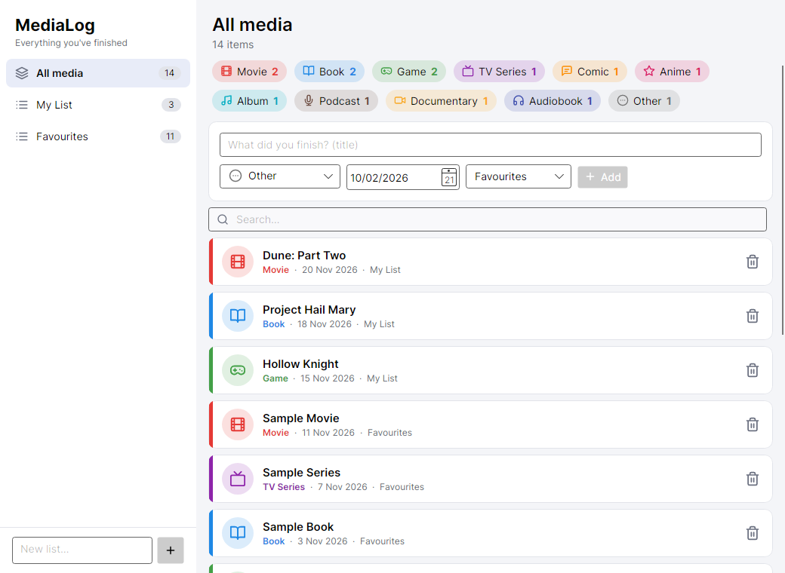
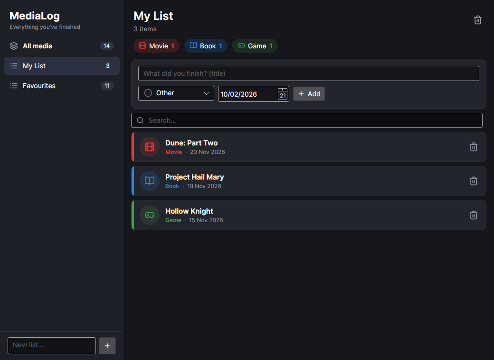

# MediaLog

A small cross‑platform app (Windows, Linux, Android) built with **Avalonia 12** and **.NET 10** to keep
lists of the media you've finished — movies, series, books, games, comics, anime, albums, podcasts,
documentaries, audiobooks…

| Desktop | Phone | Dark |
|---|---|---|
|  |  |  |

## Features

- **Lists** – create as many lists as you like (e.g. "2026", "Favourites"); rename by clicking the title, delete from the header.
- **Entries** – name, type, date completed; each type has its own **color** and **icon**.
- **All media (master list)** – every entry from every list, with the **total count** and a color‑coded counter per type.
- Click a type chip to filter by it; search by title; entries sorted by completion date (newest first).
- Undo for deleted entries.
- Responsive: sidebar on wide screens, hamburger/overlay menu on phones. Follows the system light/dark theme.
- Data is saved automatically as JSON in the per‑user app data folder
  (`%LOCALAPPDATA%\MediaLog\library.json` on Windows, `~/.local/share/MediaLog/library.json` on Linux,
  app‑private storage on Android).

## Project layout

```
MediaLog/            shared app: models, view models, views (all UI lives here)
MediaLog.Desktop/    Windows + Linux entry point
MediaLog.Android/    Android entry point
```

Media types (label, color, icon) are defined in `MediaLog/Models/MediaTypeInfo.cs` — add a value to
`MediaKind` and a line there to introduce a new type.

## Build & run

Requires the [.NET 10 SDK](https://dotnet.microsoft.com/download).

```sh
# Desktop (Windows / Linux)
dotnet run --project MediaLog.Desktop

# Self-contained single-file builds
dotnet publish MediaLog.Desktop -c Release -r win-x64   --self-contained -p:PublishSingleFile=true
dotnet publish MediaLog.Desktop -c Release -r linux-x64 --self-contained -p:PublishSingleFile=true

# Android (needs: dotnet workload install android, plus an Android SDK and JDK 17+)
dotnet build MediaLog.Android -c Release            # APK in MediaLog.Android/bin/Release/net10.0-android/
dotnet build MediaLog.Android -t:Run                # deploy to a connected device / emulator
```

If the Android SDK isn't found automatically, pass `-p:AndroidSdkDirectory=<path>`
(and `-p:JavaSdkDirectory=<path>` for the JDK).
