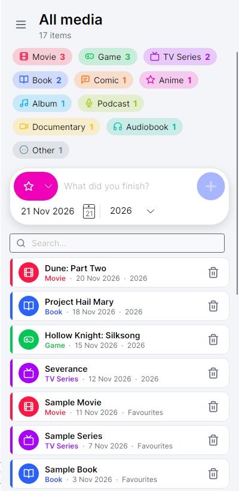
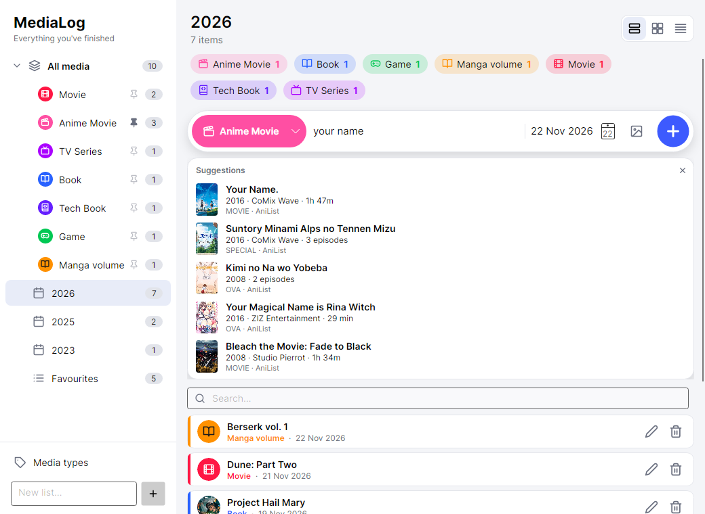
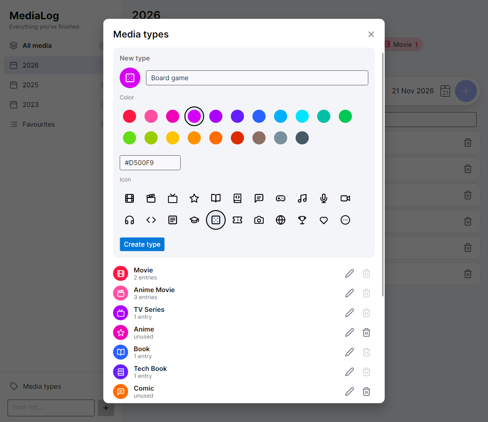
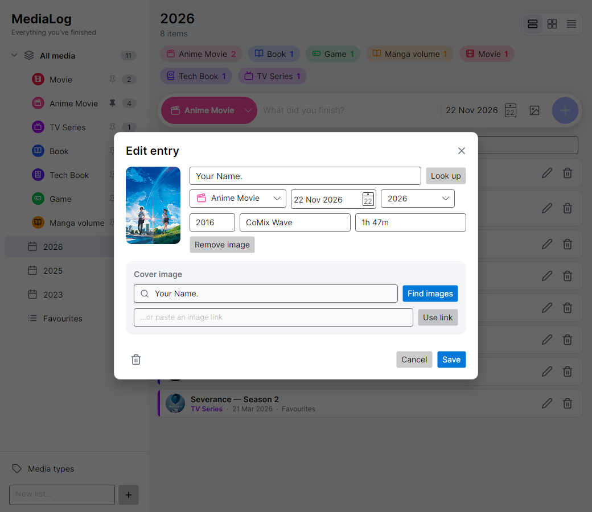
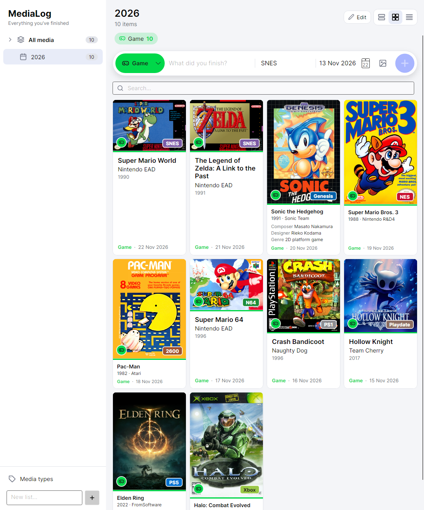
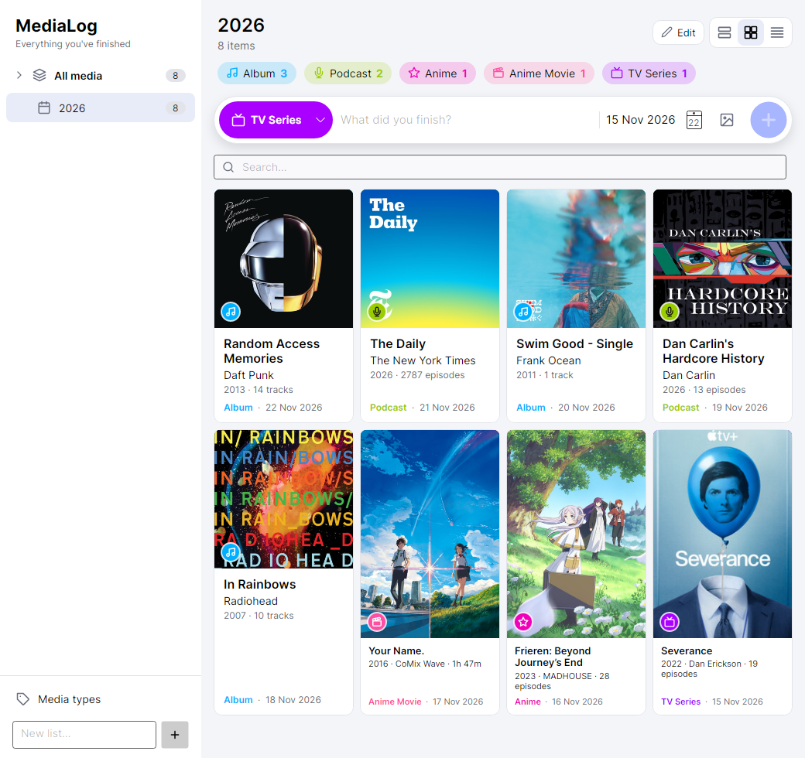
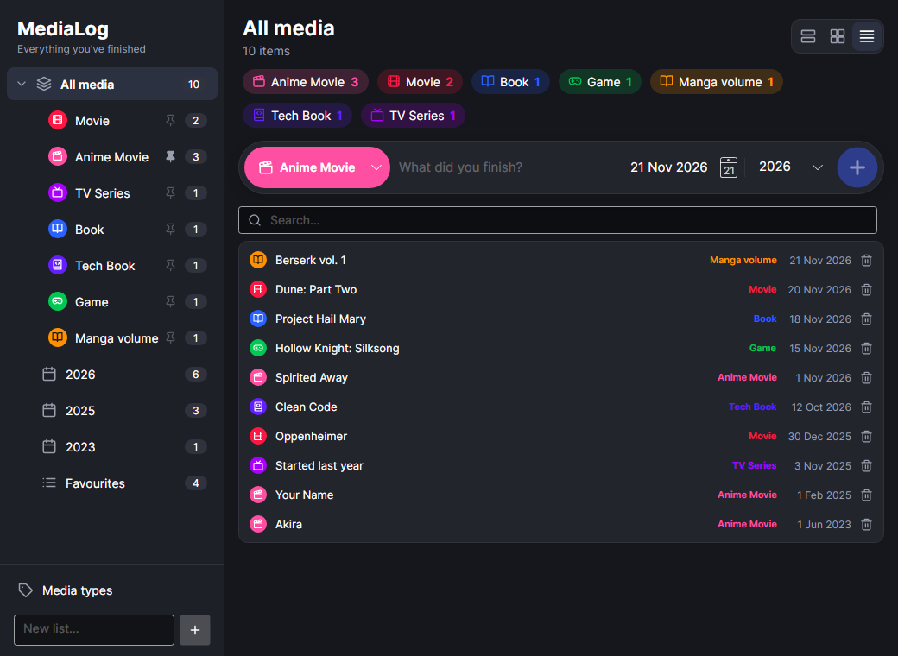

# MediaLog

A small cross‑platform app (Windows, Linux, Android, iOS and the browser) built with **Avalonia 12** and **.NET 10** to keep
lists of the media you've finished — movies, series, books, games, comics, anime, albums, podcasts,
documentaries, audiobooks…

| Desktop | Phone | Dark |
|---|---|---|
|  |  |  |

## Features

- **Year lists** – a list for the current year (e.g. "2026") is created automatically and is the default.
  A year list shows *every* entry completed that year, including those stored in your custom lists, and
  there's one for each year that has entries. Past years are kept; on New Year a fresh list appears
  (even while the app is open). Adding an entry dated in another year files it under that year.
- **Custom lists** – create as many extra lists as you like (e.g. "Favourites"); rename by clicking the title, delete from the header.
- **Entries** – added from a one-line bar: type · title · date · cover · big **+** button (or press Enter).
  The cover button searches images for the title being typed so the entry is added with its cover.
- **Title lookup** – while you type a title, matching works are suggested from online databases with
  their proper name, cover and details: **year**, **creator** (director, author, studio, developer,
  artist…) and **length** (running time, episodes, pages, tracks…). Picking one fills it all in; the
  details are shown on the entry and editable in the editor (which also has a *Look up* button).
  Games and movies also get **credits** from Wikidata (director, composer, producer, publisher,
  designer, genre; writer and cast for movies), also filled in when a box-art match is picked.
  Sources (free, no keys) by type: Wikidata (movies, documentaries, games, other), TVmaze (series),
  AniList (anime, manga), Google Books / Open Library / iTunes (books, comics), iTunes (albums,
  podcasts, audiobooks).

  
  Each type has its own vivid **color** and **icon**.
- **Media types** – 13 built-in types (incl. *Tech Book* and *Anime Movie*); create your own or edit any
  type's name, color and icon from **Media types** in the sidebar. Types that are in use can't be deleted.

  
- **All media (master list)** – every entry from every list, with the **total count** and a color‑coded counter per type.
  The arrow next to it expands one list per type (only types with entries). **Pin** a type list to keep
  it in the sidebar even when "All media" is collapsed.
- **Editing** – the **Edit** button at the top shows edit / delete buttons on every entry (hidden
  otherwise); the pencil opens an editor for title, type, date and list (moving it
  between lists), plus a **cover image**: *Find images* searches online by title and shows a grid of
  suggestions to pick from (or paste any image link). Covers show in tiles mode — uncropped, each tile taking the image's own shape (wide SNES / N64
  boxes, tall posters, square album art; square-ish covers get a roomier info layout) — and as the
  entry badge,
  and are cached on disk so they work offline.
  Image sources (free, no API keys), chosen by type: Wikipedia, TVmaze (series), Open Library (books),
  iTunes (albums, podcasts, audiobooks, ebooks, movies), AniList and Jikan/MyAnimeList (anime, manga).
  Results appear as each source answers; a source that takes over 6 s is skipped.

  
- **Consoles** – games have a console field (with suggestions; typing an unknown console adds it).
  Each console shows as a small badge in its own color (SNES purple, Genesis blue, NES red, PS5…).
  Covers for retro games (NES, SNES, N64, Game Boy, Genesis, Atari 2600, PlayStation, Xbox…) come from
  the [libretro-thumbnails](https://github.com/libretro-thumbnails) box-art collection for that console,
  which is also searched for title suggestions once a retro console is set. Game titles are looked up
  with a full-text Wikidata search, so any words of the title match.
- Title suggestions are word-based everywhere: words can be typed in any order and partially
  ("a link to the pa" → *The Legend of Zelda: A Link to the Past*); results are ranked by how many
  of the typed words they contain.

  
- **View modes** – every list can be shown as *cards* (default), *tiles* or *compact* rows; the choice
  is remembered per list.

  | Tiles | Compact |
  |---|---|
  |  |  |
- Click a type chip to filter by it; search by title; entries sorted by completion date (newest first).
- Undo for deleted entries.
- Responsive: sidebar on wide screens, hamburger/overlay menu on phones. Follows the system light/dark theme.
- Data is saved automatically as JSON in the per‑user app data folder
  (`%LOCALAPPDATA%\MediaLog\library.json` on Windows, `~/.local/share/MediaLog/library.json` on Linux,
  app‑private storage on Android/iOS, `localStorage` in the browser).

## Project layout

```
MediaLog/            shared app: models, view models, views (all UI lives here)
MediaLog.Desktop/    Windows + Linux entry point
MediaLog.Android/    Android entry point
MediaLog.iOS/        iOS entry point
MediaLog.Browser/    WebAssembly entry point (stores data in localStorage)
```

The default media types are listed in `MediaLog/Models/MediaTypeDef.cs` and the available icons in
`MediaLog/Models/TypeIcons.cs`; user-created types are stored in the library file.

## Build & run

Requires the [.NET 10 SDK](https://dotnet.microsoft.com/download).

```sh
# Desktop (Windows / Linux)
dotnet run --project MediaLog.Desktop

# Self-contained single-file builds
dotnet publish MediaLog.Desktop -c Release -r win-x64   --self-contained -p:PublishSingleFile=true
dotnet publish MediaLog.Desktop -c Release -r linux-x64 --self-contained -p:PublishSingleFile=true

# Android (needs: dotnet workload install android, plus an Android SDK and JDK 17+)
dotnet build MediaLog.Android -c Release            # APK in MediaLog.Android/bin/Release/net10.0-android/
dotnet build MediaLog.Android -t:Run                # deploy to a connected device / emulator

# iOS (needs a Mac with Xcode: dotnet workload install ios)
dotnet build MediaLog.iOS -t:Run

# Browser / WebAssembly (needs: dotnet workload install wasm-tools)
dotnet run --project MediaLog.Browser               # dev server
dotnet publish MediaLog.Browser -c Release          # static site in bin/Release/net10.0-browser/publish/wwwroot
```

If the Android SDK isn't found automatically, pass `-p:AndroidSdkDirectory=<path>`
(and `-p:JavaSdkDirectory=<path>` for the JDK).
